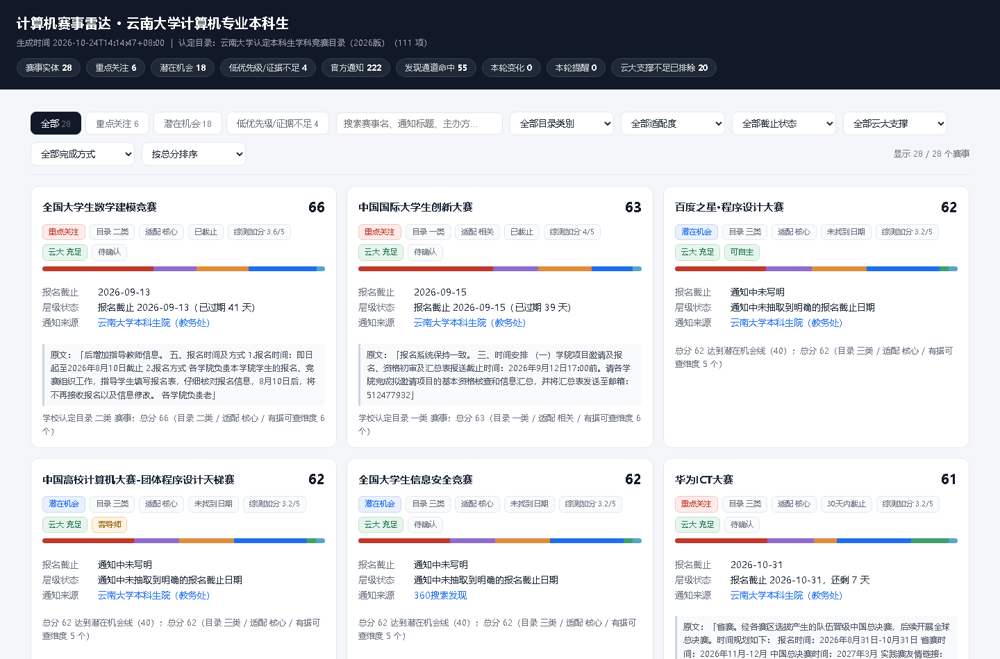

# 计算机赛事雷达

面向云南大学计算机科学与技术专业本科生的赛事发现与评估工具：定期从官方渠道和公开来源采集竞赛信息，
对照学校官方认定目录做核查，给出可解释的分级结论，并只对需要行动的信息推送提醒。



<sub>筛选、搜索、排序、分数构成条形图、详情弹窗，见 [docs/screenshots](docs/screenshots)。</sub>

## 当前运行状态

| 项目 | 状态 |
| --- | --- |
| 计划任务 | 已注册 `CompRadar-Weekly`，每周一 09:00 自动运行，日志在 `outbox/run.log` |
| 推送渠道 | 已启用 Windows 桌面通知（零配置）；企业微信 / Server酱 / 邮件待填密钥 |
| 认定目录 | 《学校认定本科生学科竞赛目录（2026版）》111 项，保留 2025 版用于降级判断 |
| 综测规则 | 已接入《2023 级计科综合评测细则》，可逐赛事算出加分 |
| 自检 | `python -m radar doctor` 全部通过 |

换机器或过一段时间后想确认还能不能跑，先执行一次 `python -m radar doctor`。

## 一、它解决什么问题

1. **发现**：除了你已经知道的比赛，还通过官方栏目 + 主动检索通道去找新的赛事。
2. **核实**：目录认定、综测赋分、保研价值是三个不同概念，本工具**分维度留证**，不互相替代。
3. **提醒**：识别新赛事、报名开放、临近截止、日期变化，并且不重复推送。

## 二、快速开始

```powershell
# 1. 安装依赖（只需要三个库）
pip install -r requirements.txt

# 2. 直接跑一轮完整流水线（采集 + 评估 + 出报告 + 仪表盘）
#    认定目录和综测规则已经作为数据文件提交，开箱可用
python -m radar run

# 3. 生成人工核对清单
python -m radar verify

# 4. 打开仪表盘
python -m radar dashboard --open

# 5. 启用自检（逐项确认依赖、目录、规则、数据库、推送、定时任务）
python -m radar doctor
```

跑完后 `data/radar.db` 是空的、`data/raw/` 也没有缓存，第一次运行会联网抓取约 300 个页面，
耗时 2~3 分钟；之后 6 小时内再跑会直接读缓存，几秒钟出结果。

目录和综测规则本身也是可复现的：`tools/import_ynu_catalog.py` 从学校官方目录 PDF 解析，
`tools/import_szcp.py` 从计科综测细则 PDF 里抓权重表。见第十、十一节。

产出：

- `outbox/digest-latest.md`：本周周报（三级分层 + 变化提醒 + 发现通道候选）
- `outbox/cards/*.md`：重点关注赛事信息卡
- `outbox/dashboard.html`：自包含网页仪表盘（双击即可打开）
- `data/candidates.json`：结构化数据（每条都带来源链接与字段级证据）
- `data/state.json`：首次发现时间、最近核验时间、变化快照
- `data/raw/`：原始网页快照，可按 URL 哈希复核

## 三、命令

| 命令 | 说明 |
| --- | --- |
| `python -m radar run` | 完整跑一轮 |
| `python -m radar run --no-search` | 只跑官方通道，不跑搜索引擎 |
| `python -m radar run --offline` | 只读本地缓存 |
| `python -m radar run --force` | 忽略缓存，强制重新抓取 |
| `python -m radar catalog --cs` | 查看认定目录里的计算机相关赛事 |
| `python -m radar verify --limit 40` | 生成人工核对清单 |
| `python -m radar status` | 查看库内状态与等级分布 |
| `python -m radar db --pushes` | 查看数据库总量、最近变化与提醒记录 |
| `python -m radar notify` | 检查通知配置并预览待推送内容 |
| `python -m radar notify --test` | 真实发送一条测试消息（用于验证渠道配置） |
| `python -m radar notify --redeliver 3` | 把最近 3 条提醒重新投递一次（换渠道后补发） |
| `python -m radar doctor` | 启用自检：逐项确认各组件是否真的可用 |
| `python -m radar dashboard --open` | 重新生成网页仪表盘并打开 |
| `python tools/demo_change_detection.py` | 独立演示库，演示"日期变化被检出 + 只推一次" |
| `python tools/demo_notify.py` | 用本地接收端演示推送正文长什么样 |
| `python tools/check_toast.py` | 验证桌面通知是否真的进了系统通知中心 |
| `python tools/render_dashboard.py` | 用真实浏览器渲染仪表盘、检查 JS 报错并截图 |
| `powershell -File scripts/install_task.ps1` | 注册每周一 09:00 自动运行的计划任务（需管理员） |

## 三之三、定时运行与推送（第三阶段）

### 开通推送

### 桌面通知（零配置，默认已启用）

`channel = "toast"` 不需要任何账号或密钥：每周运行后，如果有需要行动的信息，
右下角会弹一条 Windows 通知，点它直接打开仪表盘。

```toml
[notify]
enabled = true
channel = "toast"
dry_run = false
```

一个坑值得记下来：**用自造的 AppUserModelID 发 toast，API 不会报错，但通知会被系统静默丢弃**。
本项目借用已注册的 Windows PowerShell 身份发送，并用
`python tools/check_toast.py` 到系统通知数据库（`wpndatabase.db`）里核对记录数确实增加了，
而不是只看有没有抛异常。

### 手机推送（需要你提供密钥）

想推到手机上，改 `config/settings.toml`：

```toml
[notify]
enabled = true
channel = "wecom"     # wecom | serverchan | email
dry_run = false       # 先设 true 跑一轮看看内容，确认后再改 false
```

密钥一律走环境变量，不写进配置文件：

| 渠道 | 环境变量 | 取值 |
| --- | --- | --- |
| 企业微信机器人 | `COMPRADAR_WECOM_WEBHOOK` | 群机器人 Webhook 地址 |
| Server酱 | `COMPRADAR_SERVERCHAN_KEY` | SendKey |
| 邮件 | `COMPRADAR_SMTP_USER` / `COMPRADAR_SMTP_PASS` | 邮箱账号与 SMTP 授权码 |

Windows 下设置（当前会话有效）：

```powershell
$env:COMPRADAR_WECOM_WEBHOOK = "https://qyapi.weixin.qq.com/cgi-bin/webhook/send?key=你的key"
python -m radar notify --test
```

想永久保存，用 `setx COMPRADAR_WECOM_WEBHOOK "..."`（重新打开终端后生效）。

### 投递语义

| 状态 | 含义 |
| --- | --- |
| `sent` | 已投递成功 |
| `dry-run` | 内容已渲染到 `outbox/notifications-*.md`，但没真正发送（已消费，不会积压） |
| `pending` | 投递失败，保留错误信息，下一轮自动重试 |

失败重试不会造成刷屏：`push_key` 唯一，同一件事只会入队一次。

### 定时运行

```powershell
# 注册（用户级任务，不需要管理员）
powershell -ExecutionPolicy Bypass -File scripts\install_task.ps1
```

**当前状态：已注册**，任务名 `CompRadar-Weekly`，每周一 09:00 自动跑，日志追加在 `outbox/run.log`。
已试跑一次并返回 0（成功），下次运行时间见 `Get-ScheduledTaskInfo -TaskName CompRadar-Weekly`。

```powershell
Start-ScheduledTask   -TaskName CompRadar-Weekly   # 立刻跑一次
Get-ScheduledTaskInfo -TaskName CompRadar-Weekly   # 看上次结果与下次时间
Unregister-ScheduledTask -TaskName CompRadar-Weekly -Confirm:$false   # 删除任务
```

注意：计划任务只在机器开机时触发（未勾选"关机也运行"）；如果周一早上电脑没开，
`-StartWhenAvailable` 会让它在下次开机后补跑一次。所有脚本文件刻意只用 ASCII 字符，
避免 Windows PowerShell 5.1 按 GBK 解析 `.ps1` 时把中文弄坏。

## 三之四、网页仪表盘（第四阶段）

每次运行都会在 `outbox/dashboard.html` 生成一个**自包含**的仪表盘：CSS/JS 内联、数据以 JSON 内嵌，
不依赖任何 CDN 或网络，双击就能打开，也能直接发给别人。

功能：

- 顶部概览：本轮赛事实体数、三级分布、官方通知数、发现通道命中数、变化与提醒条数
- 筛选：等级页签、目录类别、专业适配度、截止状态、关键词搜索（赛事名/通知标题/正文/主办方）
- 排序：按总分、按报名截止、按名称
- 卡片上直接看到：等级、目录类别、总分、**分数构成条形图**（六个维度各占多少）、
  报名截止与状态、通知来源、原文片段
- 点开卡片看详情弹窗：每个维度的判定理由与原文引用、风险、下一步行动、往届获奖新闻、
  全部来源链接、首次发现与最近核验时间
- 页面下方的变化记录、提醒记录、主动发现通道命中清单

```powershell
python -m radar dashboard --open     # 只重建仪表盘并打开，不重新采集
```

分数构成条形图的颜色：目录认定 / 主办方层级 / 专业适配度 / 时效性 / 综测赋分 / 历年组织情况。
这样一眼就能看出某个赛事分数高是因为学校认定，还是因为适配电类、临期可行动。

## 三之二、数据持久化与变化监测（第二阶段）

所有结果写入 SQLite（`data/radar.db`）：

| 表 | 内容 |
| --- | --- |
| `competitions` | 赛事实体，含首次发现时间、最近核验时间、最近变化时间 |
| `notices` | 通知原文，按规范化 URL 唯一（`http/https`、带不带 `www`、结尾斜杠视为同一条） |
| `competition_notices` | 赛事与通知的关联，区分"报名通知"与"获奖新闻" |
| `valuations` | 每次运行的分维度评估快照，可回溯评分变化 |
| `changes` | 逐字段变化记录：日期、费用、组队、参赛对象、等级、目录类别等 |
| `push_log` | 已推送内容，`push_key` 唯一，保证同一件事不重复提醒 |
| `runs` | 每次运行的统计，便于回溯 |

**会记录的变化类型**：日期变化、费用变化、组队规则变化、参赛资格变化、赛程变化、主办方变化、
名称变化、等级变化（升/降级）、目录类别变化。

**会推送的情况**（其余一律不打扰）：

1. `首次发现`：新出现的赛事（且等级在"重点关注/潜在机会"）
2. `临近截止`：报名截止进入 30 天窗口
3. `日期变更`：报名截止日期发生变化
4. `等级提升`：升级为"重点关注"
5. `新增通知`：重点关注赛事挂了新的通知

推送先落到 `outbox/notifications-<日期>.md`，渠道开关见 `[notify]`（第三阶段接入企业微信/邮件时复用同一份去重记录）。

### 分层规则（第二阶段重新校准）

满分约 77 分 = 目录 30 + 适配 16 + 主办 12 + 时效 10 + 综测 5 + 历年 4。

- **重点关注**：适配度合格，且满足下列任一 —— ① 学校认定为**一类/二类**；② 总分 ≥ 62 且有据可查的维度 ≥ 2；
  ③ **计算机核心赛道 + 30 天内截止** + 总分 ≥ 50（可立即行动）。
- **潜在机会**：总分 ≥ 40。
- **低优先级/证据不足**：其余；适配度为"弱"的赛事直接落此档。
- 保护规则：只有获奖新闻、没有本年度报名通知的赛事不能进"重点关注"。

## 四、目录结构

```
comp-radar/
├─ config/           配置（TOML）
│   ├─ settings.toml   频率、超时、缓存、通知渠道开关
│   ├─ sources.toml    采集源清单与解析规则
│   ├─ keywords.toml   领域关键词、重点跟踪名单、发现检索式
│   └─ scoring.toml    评分权重与分层阈值
├─ radar/            主程序
│   ├─ net.py        抓取层：限速 / 重试 / robots / 原始快照 / 缓存
│   ├─ sources.py    采集层：官方栏目直采 + 搜索引擎发现
│   ├─ parse.py      解析层：列表页 / 详情页
│   ├─ extract.py    抽取层：日期、费用、组队、参赛对象、主办方
│   ├─ catalog.py    云南大学认定目录的加载与匹配
│   ├─ evaluate.py   评估层：分维度计分 + 三级分层
│   ├─ report.py     报告层：周报 + 信息卡
│   ├─ pipeline.py   编排
│   └─ cli.py        命令行
├─ tools/            目录导入、匹配自检、结果查看
├─ tests/            单元测试
├─ data/             数据库/结构化数据/原始快照（自动生成）
└─ outbox/           周报、信息卡、仪表盘、提醒文件（自动生成）
```

## 五、数据来源与可信度

| 来源 | 类型 | 可信度 | 用途 |
| --- | --- | --- | --- |
| 云南大学本科生院（教务处）`jwc.ynu.edu.cn` | 官方 | 高 | 校内报名通知、认定目录 |
| 云南大学软件学院（人工智能学院）`sei.ynu.edu.cn` | 官方 | 高 | 学院组织赛事、获奖新闻 |
| 云南大学信息学院 `ise.ynu.edu.cn` | 官方 | 高 | 计算机科学与工程系相关赛事通知 |
| 中国高等教育学会 `cahe.edu.cn` | 主办方/学会 | 较高 | 竞赛工作动态 |
| 360 搜索（含各高校教务处站点） | 聚合 | 中，需交叉核实 | 发现尚未被校内转发的赛事 |

当前使用的两份基准文件：

| 文件 | 版本 | 用途 |
| --- | --- | --- |
| `data/catalog_ynu_2026.json` | 学校认定本科生学科竞赛目录（2026版），111 项 | 目录认定维度 |
| `data/catalog_ynu_2025.json` | 学校认定本科生学科竞赛目录（2025版），126 项 | 判断"掉出 2026 目录"的竞赛，按降一级处理 |
| `data/szcp_college.json` | 2023 级计科综合评测细则 v3.2 | 综测加分计算 |
| `data/szcp_ynu.json` | 云大学〔2020〕2号 校级办法线索 | 加分模块与上限 |

采集遵守 robots.txt、同域限速、失败退避；不绕过登录、付费墙或访问限制。
搜索通道只作为"发现线索"，最终结论以官方原文为准。

## 六、评估方法

六个分维度独立计分，任何一个维度都不能单独决定结论：

1. **云南大学认定目录**（一类 30 / 二类 26 / 三类 20 / 四类 12 / 未收录 0）——证据是官方目录文件与条目号。
2. **综合测评赋分**（赛事级已核实 10 / 校级已核实 5 / 未核实 0）——目前是**赛事级已核实**：
   学科竞赛获奖落在《云南大学本科学生综合素质测评办法》（云大学〔2020〕2号）的 G22 模块（上限 5 分），
   具体分值按《2023 级计科综合评测细则》逐赛事算出。见下面「十、综测加分怎么算」。
3. **主办方层级**（国家级 / 学会级 / 省级 / 企业级 / 未知）——依据通知原文中的主办单位表述。
4. **与计算机专业适配度**（核心 / 相关 / 弱）——依据赛事名与通知中的关键词。
5. **时效性**（报名开放 / 30 天内截止 / 90 天内截止 / 未找到日期 / 已截止）。
6. **历年组织情况**（两年及以上 4 / 仅一年 2 / 无记录 0）——依据数据库中的历年校内通知，判断赛事是否持续举办。

分层规则（`config/scoring.toml`）：

- **重点关注**：适配度合格，且满足任一 —— ① 目录**一类/二类**；② 总分 ≥ 67（满分约 82）且有据可查维度 ≥ 2；
  ③ **计算机核心赛道 + 30 天内截止**且总分 ≥ 50（可立即行动）。
- **潜在机会**：总分 ≥ 40。
- **低优先级/证据不足**：其余情况。
- 额外保护：只有获奖新闻、没有本年度报名通知的赛事不能进入"重点关注"。

## 七、需要你提供的配置

都不阻塞使用，默认是先落到 `outbox/` 文件：

1. **通知渠道**（`config/settings.toml` 的 `[notify]`）：需要你提供企业微信 Webhook 地址、Server酱 SendKey 或 SMTP 账号。配置方法见上面「三之三」。
2. **可选大模型**（`[llm]`）：默认关闭。规则抽取优先，开启后仅作为兜底，且不用于生成事实。
3. **个性化**：在 `config/keywords.toml` 的 `always_track` 里加你特别关注的赛事名，或在 `off_domain` 里排除你不想看的领域。

## 八、已知局限

- 中国高等教育学会列表页是前端渲染的，当前只取到静态链接，需要浏览器渲染支持（未启用）。
- 学生评价维度目前没有稳定来源，信息卡里统一写"未找到足够可靠的公开评价"，不会生成主观评价。
- 综测加分按《2023 级计科综合评测细则》计算，该细则适用于计算机科学与技术专业 2023 级；
  其他年级或专业方向可能有各自细则，换用时请重新导入。
- 加分估算取的是「国家级一等奖 + 团队排名第一」的上限情形；实际得奖等级与队内排名会按权重递减。
- 认定目录已更新为 2026 版；2025 年通知仍按当时目录记录，历史类别变化见 `changes` 表。
- 日期抽取依赖原文表述，抽不到时明确标注，不做推测。

## 十、综测加分怎么算

学校层面的《云南大学本科学生综合素质测评办法》（云大学〔2020〕2号）只规定到模块和上限：
学科竞赛获奖计入 G22「科研创新创业实践加分项」，**上限 5 分**，具体分值由各学院细则规定。

计算机科学与技术专业的《2023 级计科综合评测细则》给出了可计算的公式：

```
成果加分 = 成果基础分 × 竞赛分类等级权重 × 获奖等级分值权重 × 团队排名分值权重
```

| 因子 | 取值 |
| --- | --- |
| 成果基础分 | 国家级（含跨境）4 分；省级 2 分 |
| 竞赛分类等级权重 | 一类 1.0 / 二类 0.9 / 三类 0.8 / 四类 0.7 / 五类 0.6 |
| 获奖等级分值权重 | 一等及以上 1.0 / 二等 0.6 / 三等 0.3 / 其他 0.1 |
| 团队排名分值权重 | 第一 1.0 / 第二 0.6 / 第三 0.3 / 其他 0.1 |
| 本项上限 | 5 分（同一竞赛就高不就低，不累加） |

举例：全国大学生软件测试大赛（2026 版目录四类）拿国家级一等奖、团队排名第一：
`4 × 0.7 × 1.0 × 1.0 = 2.8 分`。

细则还规定：**列入 2025 年目录但未列入 2026 年目录的竞赛，按降一级处理**（四类降为五类，权重 0.6）。
本项目同时加载两版目录，会自动识别这种情况并在信息卡里标注降级来源。

数值不是手抄的：`tools/import_szcp.py` 用正则从细则 PDF 里抓出权重表，抓不到关键项就直接报错，
并记录来源 PDF 的 sha256 便于复核。

```powershell
python tools/extract_pdf_text.py "<细则.pdf>" data/raw/szcp_xueyuan.txt
python tools/import_szcp.py data/raw/szcp_xueyuan.txt "<细则.pdf>" data/szcp_college.json
```

## 十一、如何更新认定目录

```powershell
# 1. 把新版目录 PDF 抽成文本并解析成结构化目录
python tools/import_ynu_catalog.py --pdf data/raw/catalog_2026.pdf `
  --source-url "学校官方附件" --version "2026版" --out data/catalog_ynu_2026.json

# 2. config/settings.toml 里把 catalog 指向新文件，catalog_prev 指向上一版

# 3. 如果换了主键格式，迁移老库（保留首次发现时间与历史）
python tools/migrate_keys.py
```

赛事实体的主键刻意用「赛事名」而不是「目录序号」：2026 版目录从 126 项变成 111 项，序号会整体位移，
用序号当主键会让同一场比赛在新版目录里被当成新赛事。

## 九、阶段路线

- **第一阶段（已完成）**：官方栏目 + 检索通道采集真实赛事，结构化输出，验证来源、日期与分类准确性。
- **第二阶段（已完成）**：SQLite 持久化、逐字段变化监测、历史回溯、推送去重、分层规则重校准。
- **第三阶段（已完成）**：企业微信 / Server酱 / 邮件三个渠道 + 干跑模式 + 失败重试 + 计划任务脚本。
  只差你把自己的 Webhook 或邮箱账号填进环境变量。
- **第四阶段（已完成）**：自包含网页仪表盘，含筛选、搜索、排序、分数构成条形图与详情弹窗，
  用真实浏览器渲染验证过（无 JS 报错）。
